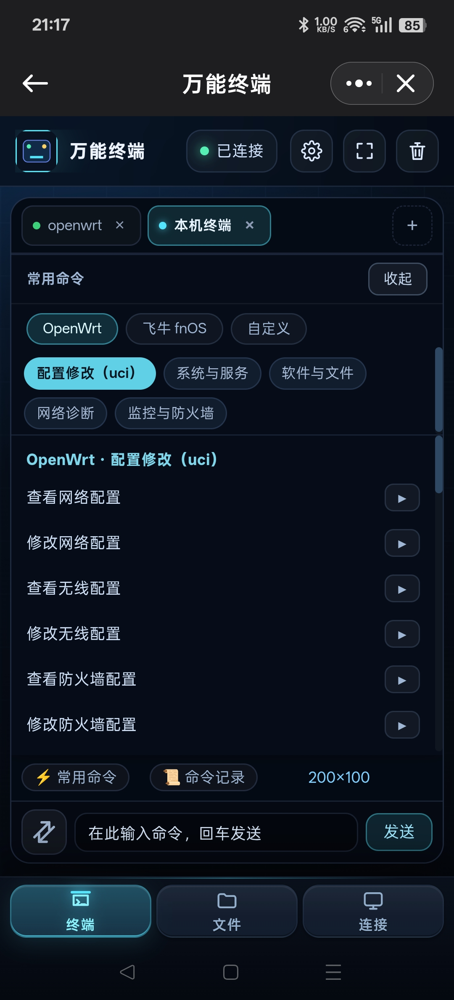
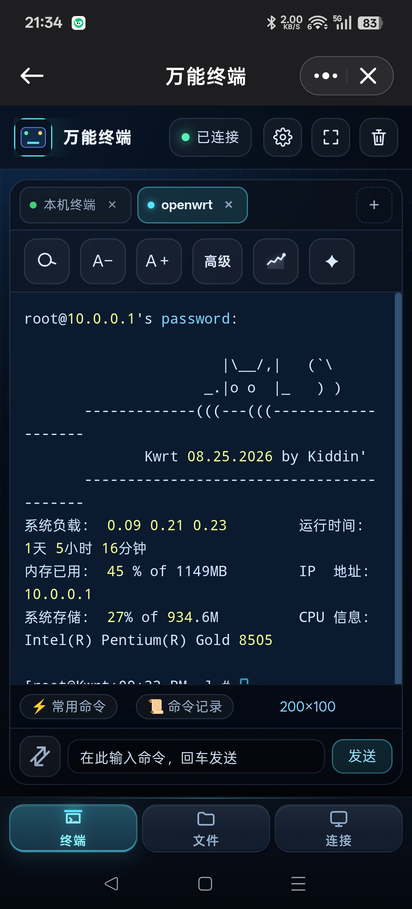
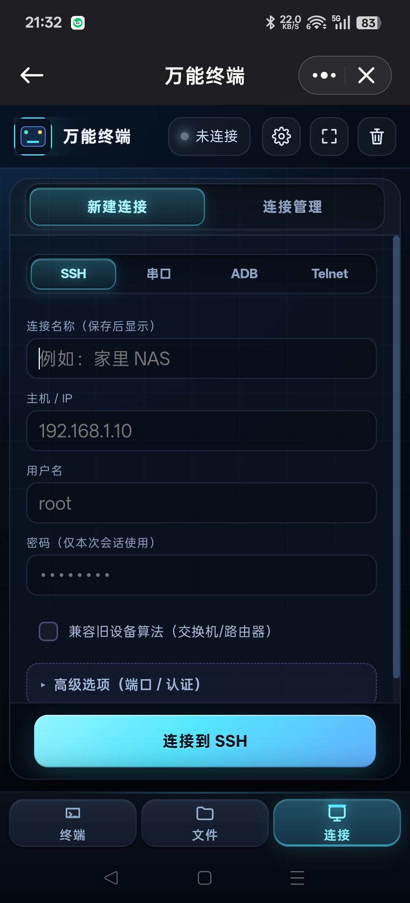
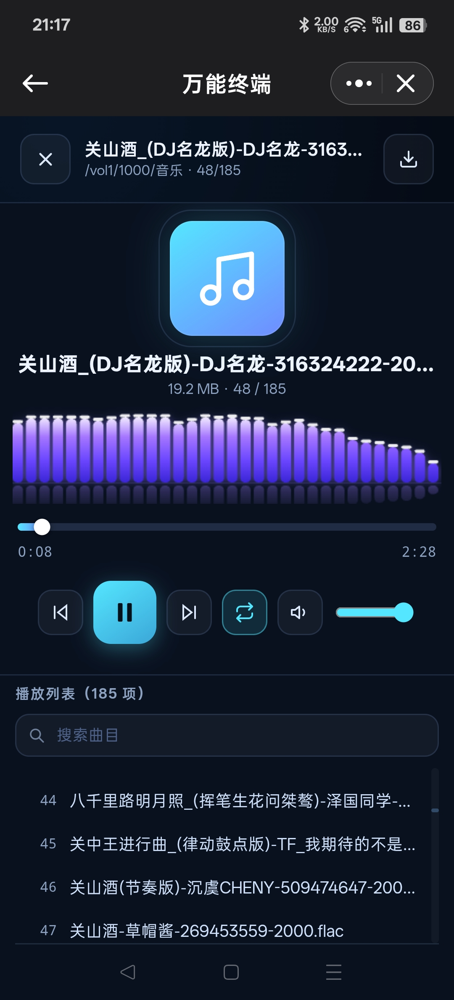
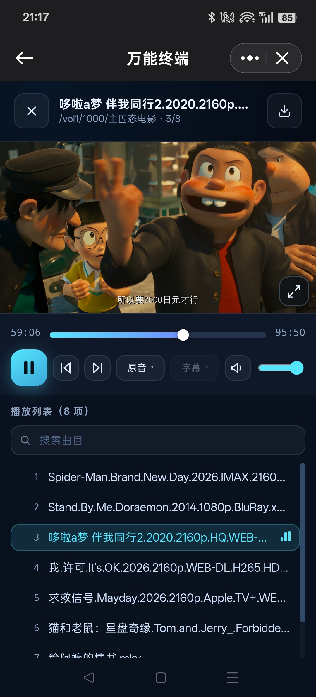

# 万能终端

> 飞牛 fnOS 原生终端 —— 一台设备管理全部连接。
> 支持 **SSH · 串口 · Telnet · ADB · 本机终端**，x86 / ARM 双架构。

---

## 五种连接方式

| 方式 | 典型用途 | 说明 |
| :--- | :--- | :--- |
| **SSH** | NAS、服务器、OpenWrt 路由 | 密码 / 私钥登录，连接复用，兼容 OpenWrt / BusyBox |
| **串口** | 交换机、路由器 Console 线 | 自定义波特率，专治老设备怪脾气（见下） |
| **Telnet** | 老式网络设备 | 轻量直连 |
| **ADB** | 安卓手机、电视、盒子 | 无需 root 即可管理 |
| **本机终端** | 飞牛本机 shell | 打开即用，无需任何连接配置 |

---

## 功能一览

### 多标签 · 多会话

一台设备上同时开多个连接，标签页自由切换：本机终端、SSH、爱快 SSH、小米电视 ADB 各占一页，互不干扰。会话列表常驻左侧，随时回看。

### 新建连接 · 连接管理

一个表单覆盖 SSH / ADB / Telnet，填主机、账号、密码即可连；高级选项可指定端口与认证方式。连过的都存在「连接管理」里，下次一键重连。

### 常用命令库

内置 **OpenWrt / fnOS / 自定义** 三组命令，比如「查看网络配置 `cat /etc/config/network`」「修改防火墙配置 `vi /etc/config/firewall`」。点击可填入输入框，也可直接立即执行，不用背命令。

**命令记录**：无论命令框输入、终端内输入还是点常用命令发送，只要发出命令就会记录，随时翻历史。

### 本机终端 + 系统监控

免连接直接进本机 shell，右侧实时显示系统负载、内存占用、CPU 型号与 IP 地址。

### 远端文件浏览 · 本地直读

- 目录浏览，支持**多选批量**操作
- 权限修改、指定编码打开文本、压缩与解压
- **GB 级分片上传下载**，大文件不中断
- **本地直读**：直接浏览飞牛本机 `/vol1`、`/vol3` 等卷，无需绕道 SSH

### 媒体预览与播放

- **音乐**：flac 等格式直接播放，带播放列表，185 首曲目也能秒搜
- **视频**：mkv 直出，支持字幕，2160p 也能放

### 终端个性化：12 款配色

在「设置 → 通用 → 终端个性化」里挑，实时预览、切换即生效：

- **cmd** —— Windows 终端经典黑白
- **柔白** —— 暖白底配近黑字，对比度 13.27，长时间看不伤眼
- **黑客绿**、**暗紫**、**午夜蓝**、**深灰**、**墨绿**、**琥珀**、**蓝黑**、**石榴红**、**青碧**、**暖砂**

### 语法高亮

串口与 Telnet 输出自动着色：提示符、接口名、链路状态 UP / DOWN（绿 / 红）、MAC 与 IP、`%` 报错整行标红、`---- More ----` 压暗。换配色时正文跟随前景色，token 保留彩色。

### 串口：专治老设备的怪脾气

串口是最容易出问题的连接方式，这几条是实际调试中踩出来的：

- **分页自动应答**：交换机输出停在 `---- More ----` 时自动翻页。实测 100 行输出可完整跑完（修复前只到 20 行就卡死）
- **分页键带回车**：设备是行缓冲的，只发空格收不到，必须补 CR
- **本地回显自动识别**：设备自己会回显时自动关闭本地回显，避免命令出现两次
- **裸 `\r` 正确处理**：设备用 `\r` + 空格擦除 `More` 提示时不再误判为换行，消除多余空行
- **时间戳开关**、**自定义波特率**、**大输出合并下发**（20KB 输出从两万条消息降到两百条以内）

---

## 手机端

手机与电脑共用一套界面，触屏专门适配：终端输入、常用命令、媒体播放、文件浏览都能用。

| 终端与常用命令 | SSH 登录与系统信息 |
| :---: | :---: |
|  |  |

| 新建连接 | 音乐播放 | 视频播放 |
| :---: | :---: | :---: |
|  |  |  |

---

## 安装

在飞牛 fnOS 应用中心**手动安装**，上传对应架构的包：

| 架构 | 文件 |
| :--- | :--- |
| x86 / x86_64 | `terminal_ssh_<版本>_x86.fpk` |
| ARM / ARM64 | `terminal_ssh_<版本>_arm.fpk` |

安装后从桌面打开，或浏览器访问 `http://<飞牛IP>:7682`。

---

## 常见问题

**串口连上全是乱码？**
波特率不对。UART 是异步通信，不协商速率——以设备端为准（交换机 Console 通常是 9600）。两边不一致不会报错，只会收到乱码。

**串口很慢？**
9600 波特率的物理上限约 960 字节/秒，一条 20KB 配置至少要 20 秒。若设备支持，调到 115200 会快约 12 倍（设备端也要同步改）。

**长命令跑不完？**
老设备输出会停在 `---- More ----` 等按键。本软件已默认开启分页自动应答；若无效果，检查串口 / Telnet 面板里的「自动应答」是否被关掉。

**界面文字被误选中变蓝？**
功能按钮、命令列表、文件名的文字均为不可选，只有终端内容与输入框可选中复制。

---

## 反馈

功能增减或问题反馈：**knnliyu@gmail.com**

敝人一向从谏如流。
