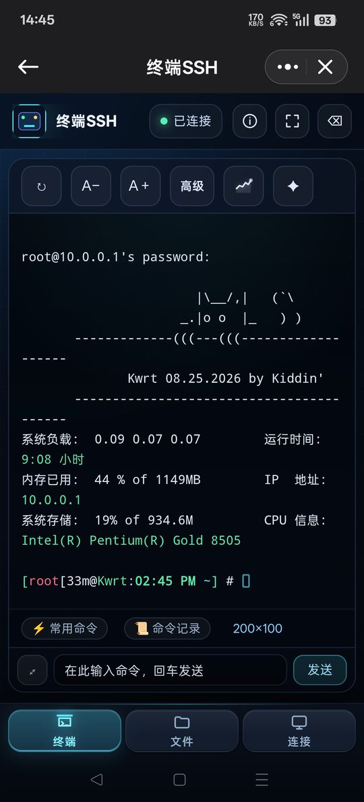
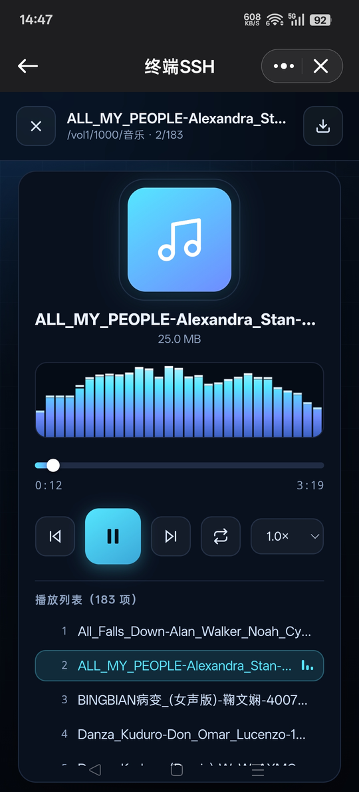
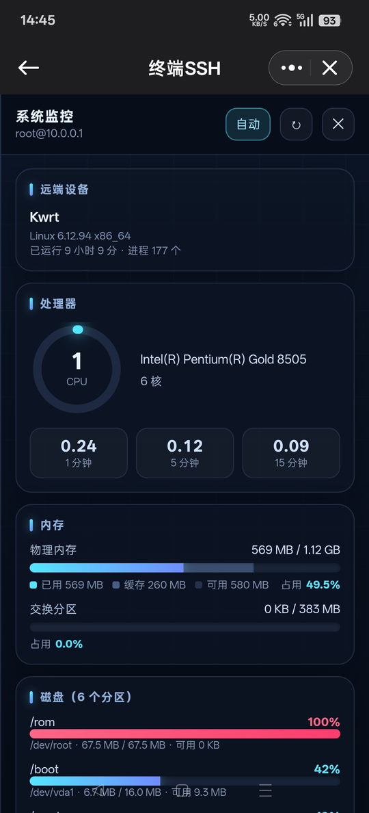
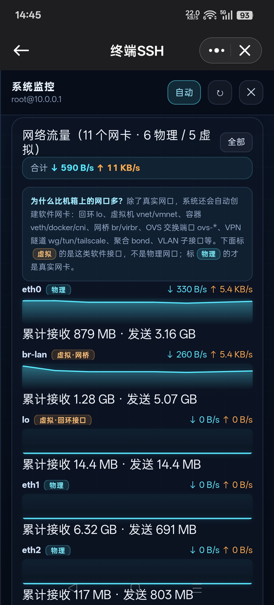
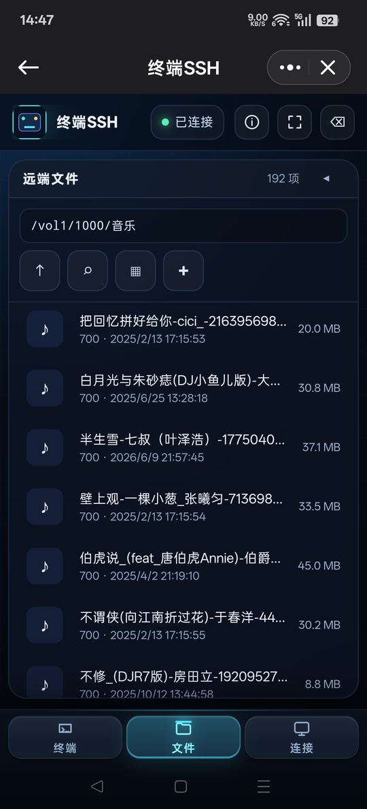
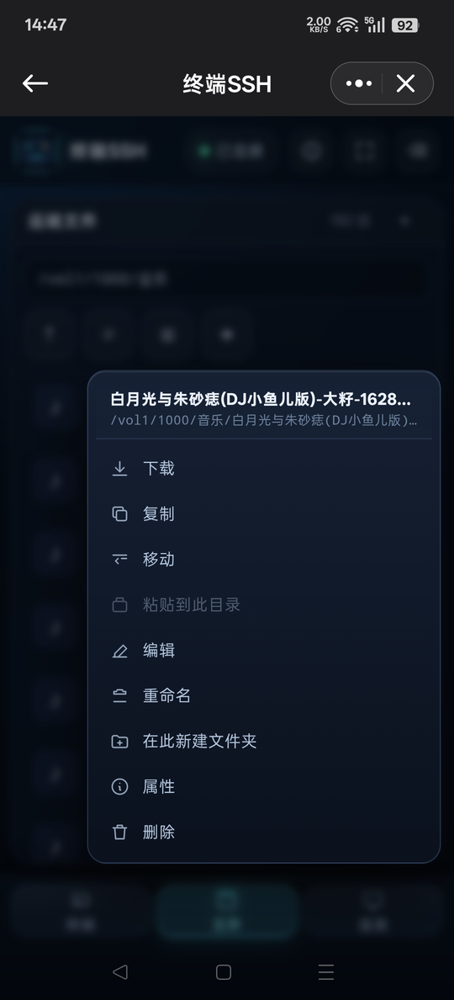
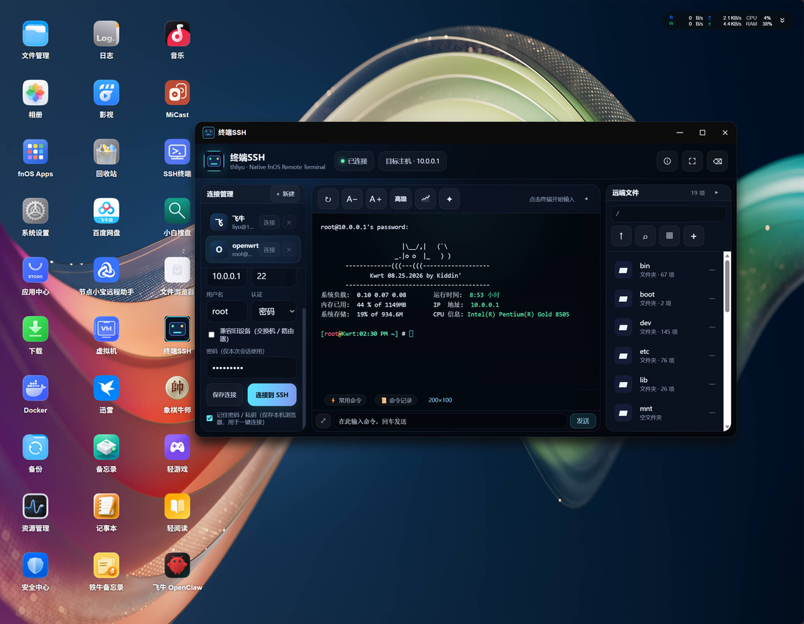
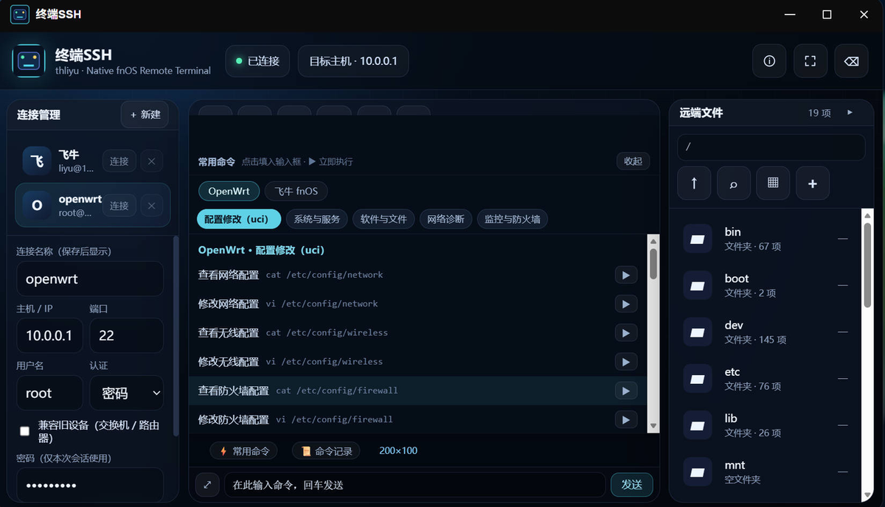
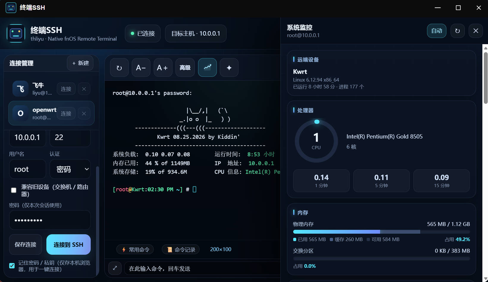
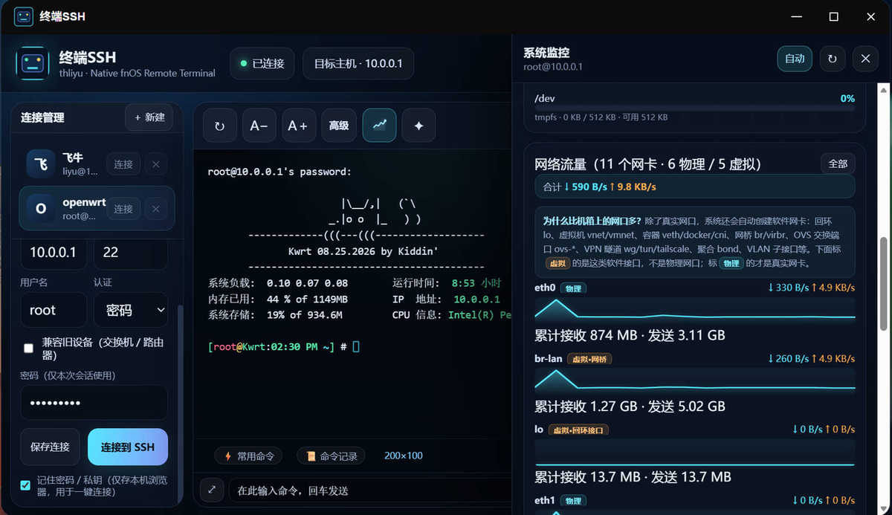

# 终端SSH（fnwebssh）

> 飞牛 fnOS 原生 WebSSH 终端。装上是桌面里的一个图标，点开就是一台真终端——能敲命令、能改配置、能翻远端文件、能直接播远端音乐和视频，还能看远端机器的实时资源占用。手机和电脑都能用。


---

## 它解决什么问题

飞牛自带的应用里没有趁手的 SSH 客户端。用浏览器开第三方 WebSSH，要么要单独部署、占端口，要么手机上没法用。

这个应用是**原生 FPK 包**：装完在飞牛桌面就是一个图标，点开在桌面窗口内打开，走飞牛统一网关，**不占任何端口**，也不用额外记一个地址。SSH 会话跑在飞牛本机，密码不落盘、只在本次会话使用。

它不只是个终端——连上之后，远端的文件能直接看、能传、能播，远端机器现在有多忙也能一眼看到，不用再开一堆工具来回切。

---

## 功能特性

### 真交互式终端

基于真实 PTY，`vim` / `top` / `less` 这类全屏程序都能正常跑，不是那种只能一条条发命令的"伪终端"。支持 ANSI 颜色、光标定位、窗口尺寸自适应。

### 内置常用命令库（281 条）

这可能是最省事的部分。内置 **281 条**常用命令，分 **11 组**，覆盖两套系统：

| 分类 | 分组 | 命令数 |
|---|---|---|
| **OpenWrt** | 配置修改（uci）· 系统与服务 · 软件与文件 · 网络诊断 · 监控与防火墙 | 136 |
| **飞牛 fnOS** | 存储与阵列 · Docker · 系统与服务 · 网络与文件 · 监控与备份 · 用户与权限 | 145 |

- 分组**横向排列**在顶部，点一下就切，不用从头往下滚
- 查看命令和修改命令**成对出现**：`查看网络配置` 下面紧跟 `修改网络配置`，改完就有得看
- 点条目填入输入框（可以再改改），点 `▶` 立即执行

### 命令自动分流：查看走终端，编辑走编辑器

不用记什么时候该用 `cat`、什么时候该用 `vi`，应用自己判断：

- **只读查看类**（`cat` / `less` / `more` / `head` / `tail`）→ 结果直接在终端显示
- **可编辑类**（`vi` / `vim` / `nano`）→ 自动用内置编辑器打开远端文件

改完点「保存」，会通过已建立的 SSH 会话写回（走 `heredoc` 覆盖写），不用再手动 `scp` 传文件。

### 内置文本编辑器

不是把 `vi` 塞进网页里硬跑，而是**读文件 → 编辑 → 写回**的模式，所以：

- 打开快，没有 vi 的模态困惑
- 支持大文件（多帧分片）
- 保存时自动补末尾换行——不补的话 heredoc 结束标记会粘在末行，shell 会卡死、文件根本不生成

编辑器打开时**命令输入框不消失**，可以随时敲命令；编辑器底部也有「常用命令 / 命令记录 / 取消 / 保存」。

### 远端文件管理

- **两种视图**：列表 / 网格，网格下显示**缩略图**
- **文件名搜索**：输入即筛，实时显示「已过滤 4 / 21」
- **子项数量**：每个文件夹后面直接显示里面有多少项（不是权限值）
- 排序、图标大小、缩略图开关都在「视图」菜单里，**设置会记住**，下次打开还是这个样子
- 文件操作：上传、下载、重命名、删除、新建文件夹、复制、移动、粘贴、查看属性

### 大文件传输（GB 级，内存恒定）

上传下载都不把整个文件读进内存，所以 1GB、8GB 的文件也不会把飞牛拖垮：

- **分片上传**：8MB 以内整包发，超过按 8MB 一片逐片追加，前端上限 8GB
- **先写临时文件再改名**：中断或失败时只删临时文件，**不会在远端留下一半的坏文件**；覆盖失败也不会损坏原文件
- **传前查空间**：先 `df` 看目标目录还剩多少，不够直接拒绝，不让你白等半天
- **进度与中断**：实时显示百分比、已完成/总量、当前速度，旁边有中断按钮
- **下载支持拖动进度条**：服务端支持 Range 请求（HTTP 206），视频可以随意拖

如果应用装在飞牛上、看的也是飞牛自己的文件，会走**本机直读**（`sendfile` 零拷贝），完全跳过 SSH 加解密，开销最低。

### 媒体播放

点开远端的文件就能播，不用先下载：

- **音频播放器**：实时频谱、可拖拽进度条、上一曲/下一曲、循环、倍速、播放列表，播完自动续下一曲
- **视频播放器**：自定义控制条（播放/进度/时间/上一个/下一个/循环/倍速/全屏），点画面即暂停

播放列表自动取当前目录下的同类型文件。切歌或关掉播放器会**立刻终止后台传输**，不会在后台继续拉数据。

> **关于格式**：能不能播取决于浏览器的解码器。稳的是 `MP4 / MKV / WebM / OGG` 配 `H.264 / VP9 / AV1` 视频 + `AAC / MP3` 音频。`AVI`、`WMV`、`FLV`、`MOV` 这类容器浏览器直接不认；MKV 里若是 **DTS / AC3** 音轨同样播不了——这是浏览器缺少授权解码器，与实现无关。

### 系统监控

工具栏点折线图图标，右侧滑出监控面板，默认 **2 秒自动刷新**：

| 卡片 | 内容 |
|---|---|
| 远端设备 | 主机名、内核版本、已运行时长、进程数 |
| 处理器 | 环形进度（按占用变色）+ 型号 + 核心数 + 1/5/15 分钟负载 + 温度 |
| 内存 | 分段条（已用 / 缓存 / 可用）+ 占用率 + 交换分区 |
| 磁盘 | 每个分区一条进度条，按占用降序，显示已用 / 总量 / 可用 |
| 网络流量 | 每个网卡实时上下行速率、累计流量 + 走势折线 |
| 本机 | 应用运行环境的 CPU / 内存，以及本应用自己占了多少 |

网卡那张卡会**标出物理网卡和虚拟网卡**，并说明为什么列表比机箱上的网口多（`lo` 回环、`veth` 容器、`br` 网桥、`ovs-*` 交换端口、`wg/tun` VPN 隧道等都是系统自动创建的）。右上角可切「仅物理」。

采集只依赖 `/proc` 和 `df`，**OpenWrt 的 BusyBox 和飞牛的 GNU 都支持**，不用装任何额外包。

### 连接管理

- 保存多个连接（如 `openwrt`、`飞牛`），点一下切换
- 密码 / 私钥两种认证
- **兼容旧设备**开关：放开 `ssh-rsa` / `ssh-dss` 和 `diffie-hellman-group1-sha1` 等老算法，连得上那些年头较久的交换机和路由器
- **连不上会说人话**：主机 IP 变了、端口不通、密码不对、没存密码……都会给出具体原因，而不是"已连接"却一片空白

### 主机密钥自愈

OpenWrt 刷机、重置、升级 dropbear 后会重新生成 ED25519 主机密钥，普通 SSH 客户端会报：

```
The fingerprint for the ED25519 key sent by the remote host is ...
Host key verification failed.
```

无人值守环境下没人能点 "yes"，就一直连不上。这个应用会自动清除冲突的旧记录并重新接受，**装上就能连**。

### 对 OpenWrt / BusyBox 的兼容

OpenWrt 用的是 BusyBox 工具集，很多 GNU 独有的参数它不认（比如 `find -printf`）。应用会**连上时先探一次对方是哪套工具**，再决定用哪种命令：

- GNU findutils → 用 `-printf`，信息最全
- BusyBox → 回退到 `-exec ls -ld {} \;`，目录和文件照样列得出来

另外会**剥离 ANSI 颜色码**——BusyBox 的 `ls` 带颜色输出时，文件名后面会残留 `[m` 这类不可见序列，不处理的话看着就像文件名坏了一样。

### 手机 / 电脑双端

同一套前端，布局自动适配：

- **电脑**：三栏（连接管理 · 终端 · 远端文件）。点「远端文件」右边的箭头可以**折叠终端、把文件面板放大到三倍宽**，此时「视图」菜单出现
- **手机**：底部页签切换（终端 / 文件 / 连接），命令条跟随输入法，全屏模式下也贴在键盘上沿

### 其它

- 命令记录：发过的命令都能翻
- 终端字号 `A-` / `A+` 调节
- 会话保持：关掉界面再回来能接回原来的会话
- 可选 AI 辅助：把自然语言转成命令并给出风险评级（需在高级设置里自行配置 OpenAI 兼容接口，**默认不启用**）

---

## 截图

### 手机端

<p align="center">
  
  &nbsp;&nbsp;
  
</p>

<p align="center">
  左：连上 OpenWrt 后的终端主界面　·　右：音频播放器，下方是自动生成的播放列表
</p>

<p align="center">
  
  &nbsp;&nbsp;
  
</p>

<p align="center">
  左：处理器与内存（环形进度按占用变色）　·　右：每个网卡的实时速率、累计流量与走势
</p>

<p align="center">
  
  &nbsp;&nbsp;
  
</p>

<p align="center">
  左：远端文件浏览　·　右：长按文件弹出的操作菜单
</p>

### 电脑端

<p align="center">
  
</p>

<p align="center">
  三栏主界面：连接管理 · 终端 · 远端文件
</p>

<p align="center">
  
</p>

<p align="center">
  常用命令面板（OpenWrt · 配置修改），分组横向排列，查看与修改成对出现
</p>

<p align="center">
  
</p>

<p align="center">
  系统监控：处理器、物理内存、交换分区
</p>

<p align="center">
  
</p>

<p align="center">
  磁盘占用与网络流量，网卡按物理 / 虚拟分类标注
</p>

---

## 安装

1. 到 Releases 下载对应架构的包：
   - `terminal_ssh_1.4.4_x86.fpk` —— x86 机器（大部分 NAS / 迷你主机），约 2.7 MB
   - `terminal_ssh_1.4.4_arm.fpk` —— ARM 机器，约 8.1 MB（内置 Python 3.9）
2. 飞牛桌面 → **应用中心** → **手动安装** → 选中 `.fpk`
3. 装完桌面出现「终端SSH」图标，点开即用

> 架构不确定的话，SSH 进飞牛执行 `uname -m`：看到 `x86_64` 选 x86，看到 `aarch64` / `armv7l` 选 ARM。

---

## 快速上手

1. 左侧「连接管理」填主机 / 端口 / 用户名 / 密码，点「连接到 SSH」
2. 想改 OpenWrt 配置：底部「⚡ 常用命令」→ 选 `OpenWrt` → 找 `修改网络配置` → 点 `▶`
3. 编辑器打开后直接改，点「保存」写回
4. 想看结果：点 `查看网络配置`，输出直接显示在终端
5. 想传文件：切到「文件」页签 → 点 `＋` → 选文件，传大文件时有进度条和中断按钮
6. 想看机器状态：点工具栏折线图图标，监控面板 2 秒刷新一次

---

## 技术实现

| | x86 | ARM |
|---|---|---|
| 运行时 | Go 二进制 | 内置 Python 3.9（随包携带） |
| 前端 | 单文件 HTML（内联 CSS / JS，无外部依赖） | 同左 |
| 通信 | WebSocket + HTTP，走飞牛统一网关 | 同左 |
| 包体 | 约 2.7 MB | 约 8.1 MB |

两端**共用同一份前后端代码**，只有运行时不同。

**文件传输有三档通道，自动选择，用户无感知**：

| 档 | 条件 | 特点 |
|---|---|---|
| SFTP | 远端有 `sftp-server` | 快，二进制安全 |
| 干净管道 | 私钥登录，或能用 askpass 绕开 PTY | 流式，不经转码 |
| base64 分片 | 只剩 PTY 可用 | 兜底，超过 8MB 会明确拒绝而不传坏 |

这里的关键在于：密码登录通常需要开 PTY 才能收密码提示，而 PTY 会改写 `\n`、吃掉控制字符，**二进制文件过一遍就坏了**。所以要么绕开 PTY（askpass），要么把数据转成 base64 让它伤不到。

---

## 常见问题

**连不上，提示 `Host key verification failed`**

升级到 1.3.73 及以上。旧版本对主机密钥变更会直接拒绝，新版本会自动清除旧记录重新接受。

**显示了"已连接"但终端一片空白**

1.4.3 之后会直接给出原因（IP 变了 / 端口不通 / 认证失败 / 没存密码），不会再出现空白的"已连接"。如果仍遇到，检查保存的连接里 IP 是否还正确——路由器断电重启后常常重新分配 IP。

**OpenWrt 上看不到任何文件夹**

1.3.76 已修复。原因是 BusyBox 的 `find` 不支持 GNU 的 `-printf`，而报错又被 `2>/dev/null` 吞掉，结果就是"目录为空"。现在会自动探测并回退到兼容写法。

**上传提示"远端空间不足，可用 0 MB"，但明明还有几十 GB**

1.3.79 已修复。原因是命令回显里的数字被误当成了磁盘容量。

**某些视频播不了**

先看是不是上面提到的格式限制。`AVI` / `WMV` / `FLV` / `MOV` 浏览器不认；MKV 若是 DTS / AC3 音轨也不行。转成 MP4（H.264 + AAC）就能播。

**能装但打不开（白屏 / 一直转圈）**

大概率是运行时没起来。SSH 进飞牛看应用日志：

```bash
cat /vol1/@appcenter/fnwebssh/app.log
```

日志里有启动自检，会打出 `uname`、`$PATH`、应用目录清单，基本一眼能定位。

**ARM 版特别大**

正常。ARM 版内置了 Python 3.9，这样机器上没装 python3 也能跑，不用联网装依赖。

**桌面图标没刷新**

覆盖安装后如果图标或入口没变，SSH 进飞牛重启应用中心服务：

```bash
sudo systemctl restart trim_app_center.service
```

---

## 许可

MIT License。

作者：thliyu · 项目主页：<https://github.com/mabuzai/fnos-Terminal-SSH>
